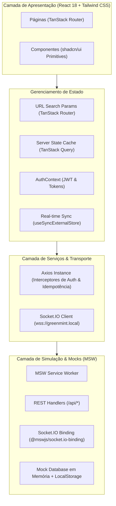

# GreenMint NFT Marketplace — Arquitetura da Solução

Este documento detalha as decisões arquiteturais, fluxos de dados, gerenciamento de estado assíncrono, estratégias de resiliência e a esteira de qualidade do **GreenMint / Kurio NFT Marketplace**.

---

## 1. Visão Geral e Topologia

O projeto segue uma arquitetura orientada a camadas com separação estrita de responsabilidades:



### Estrutura de Diretórios

```
src/
├── components/          # Componentes visuais e de navegação (Header, Footer, MobileNav)
│   └── ui/              # Primitivas reutilizáveis baseadas em shadcn/ui (Button, Badge, Card, Dialog, Skeleton, etc.)
├── contexts/            # Contextos React (AuthContext com token management)
├── hooks/               # Custom hooks de integração (useNFTs, useCart, useOrders, useProfile, useRealtimeSocket)
├── lib/                 # Funções utilitárias (formatação de moeda ETH/BRL, classes cn)
├── mocks/               # Camada MSW completa
│   ├── data/            # Fixtures oficiais e engine de banco mock em memória + LocalStorage
│   ├── handlers/        # Handlers REST divididos por domínio (auth, nfts, cart, orders, profile, reset)
│   └── socket.ts        # Handlers de WebSockets e eventos de tempo real
├── pages/               # Páginas completas da aplicação (Home, NFTDetail, Cart, Checkout, Order, Auth, Profile, Wallets)
├── services/            # Instância do Axios, tipagens de transporte e interceptores
├── types/               # Modelos e contratos TypeScript unificados
├── App.tsx              # Componente raiz, RouterProvider e QueryClientProvider
├── main.tsx             # Bootstrap da aplicação e inicialização síncrona do MSW
└── router.tsx           # Configuração de rotas tipadas do TanStack Router com Route Guards
```

---

## 2. Estratégia de Gerenciamento de Estado

A aplicação adota o princípio de **responsabilidade única** para cada tipo de estado:

| Tipo de Estado | Tecnologia | Propósito | Exemplo |
| --- | --- | --- | --- |
| **Server State** | TanStack Query | Cache de dados remotos, sincronização em segundo plano, invalidação e optimistic updates | Catálogo de NFTs, Detalhes, Carrinho, Pedidos, Perfil |
| **URL State** | TanStack Router | Estado que deve sobreviver a refresh, ser compartilhado e suportar histórico do navegador | `query`, `category`, `sort`, `page` |
| **Session State** | React Context (`AuthContext`) | Autenticação, token JWT, usuário atual e controle de expiração | `isAuthenticated`, `user`, `login()`, `logout()` |
| **Realtime State** | `useSyncExternalStore` | Conexão de WebSocket atômica sem flicker ou re-renders desnecessários | Indicador de pulso ao vivo (`LIVE`) |
| **Local Cache** | LocalStorage | Persistência entre sessões e carrinho para visitantes anônimos | Itens do carrinho anônimo, persistência do mockDb |

---

## 3. Políticas de Atualização Otimista e Rollback

Para prover interações fluidas e de alta performance, mutações críticas utilizam **atualizações otimistas**:

### 3.1. Favoritos (`useToggleFavorite`)
1. Ao clicar no botão de favorito, a UI atualiza imediatamente o contador e o estado preenchido do ícone.
2. O snapshot anterior do cache é retido no contexto do TanStack Query (`onMutate`).
3. Se a requisição à API falhar, o cache é revertido ao snapshot anterior (`onError`).
4. Em qualquer desfecho (`onSettled`), as queries `['nfts']` e `['nft', id]` são invalidadas para garantir sincronização final com o servidor.

### 3.2. Carrinho (`useAddToCart`, `useUpdateCartItem`, `useRemoveCartItem`)
1. Incrementos, decrementos e remoções aplicam cálculo imediato na cópia local do carrinho.
2. O total de itens no badge do cabeçalho é atualizado instantaneamente.
3. Se a quantidade solicitada exceder a disponibilidade da edição (`availableQuantity`) ou o limite por usuário (`maxQuantityPerUser`), a mutação falha com erro da API e o carrinho é revertido ao estado persistido.

### 3.3. Edição de Perfil e Carteiras
1. Modificações no perfil e inclusão/remoção de carteiras atualizam o cache local imediatamente e emitem invalidação subsequente.

---

## 4. Arquitetura de Mocks (MSW + WebSockets)

A aplicação não utiliza mocks acoplados aos componentes ou hooks. Toda a simulação ocorre no nível de rede através do **Mock Service Worker (MSW)**.

### 4.1. Ordem de Inicialização
Como a biblioteca `socket.io-client` (via `engine.io`) armazena uma referência para `globalThis.WebSocket` no momento da importação do módulo, o arquivo `src/main.tsx` executa `enableMocking()` **antes** de carregar o componente `App.tsx` via `import()` dinâmico. Isso garante que a interceptação de WebSockets funcione sem race conditions.

### 4.2. Persistência do Mock Database (`mockDb`)
- `mockDb` mantém as coleções completas em memória para respostas de baixa latência.
- As mutações (compras, edições de perfil, adição de carteiras, alternância de favoritos) são sincronizadas com o `localStorage`.
- No início de cada cenário de teste E2E, o endpoint `POST /api/test/reset` restaura os fixtures originais de forma determinística.

### 4.3. Eventos em Tempo Real via Socket.IO
- Configurado via `@mswjs/socket.io-binding` no endpoint `wss://greenmint.local/*`.
- Emite eventos a cada 15 segundos simulando:
  - `nft:price_update`: Atualizações de preço em tempo real de NFTs no catálogo.
  - `nft:drop`: Notificações de novos drops de coleções.
- Permite que o carrinho e a tela de checkout revalidem preços dinamicamente.

---

## 5. Idempotência e Tratamento de Concorrência

Para garantir integridade nas operações de compra e prevenir pedidos duplicados (duplo clique ou reenvios após oscilação de rede):

1. **Idempotency Keys**: A tela de checkout gera um identificador único de idempotência (UUIDv4) vinculado à tentativa de compra atual.
2. **Envio via Header HTTP**: O cliente Axios despacha o cabeçalho `Idempotency-Key: <UUID>`.
3. **Deduplicação no Backend Simulado**: O handler `POST /api/orders` inspeciona a chave de idempotência. Se uma requisição com a mesma chave já tiver sido processada, ela retorna o pedido original existente sem debitar estoque ou gerar novo recibo.
4. **Desabilitação Visual**: O botão "Confirmar pedido" entra em estado de carregamento e é imediatamente desabilitado ao primeiro clique, prevenindo submissões concorrentes.

---

## 6. Acessibilidade (A11y) e Design System

- **Padrão WAI-ARIA**: Componentes interativos implementam semântica ARIA completa (`aria-label`, `aria-busy`, `aria-selected`, `aria-current="page"`, `role="region"`).
- **Navegação por Teclado**: Foco visível (`focus-visible:ring-2`) em todos os elementos clicáveis e campos de formulário.
- **Tokens de Cor & Contraste**: Paleta extraída diretamente do Figma da GreenMint / Kurio com taxa de contraste em conformidade com WCAG AA / AAA.
- **Skeletons Estruturais**: Skeletons espelham exatamente as dimensões e proporções (`aspect-square`) dos elementos finais carregados, erradicando o Cumulative Layout Shift (CLS = 0).

---

## 7. Estratégia de Testes e Auditoria

### 7.1. Testes End-to-End (Playwright)
Cobrem os 12 cenários obrigatórios definidos no desafio, executados tanto em **Desktop Chromium (1280x720)** quanto em **Mobile Safari / Chrome (390x844)**:
1. Busca, filtros combinados, ordenação, paginação e histórico de navegação na URL.
2. Acesso direto a detalhes de NFT e tratamento de 404 (NFT inexistente).
3. Cadastro de usuário, login, logout, expiração de sessão e troca de usuário com limpeza de cache.
4. Favoritos com atualização otimista e persistência em sessão.
5. Carrinho com alteração de quantidades, remoção, cupom (`GREEN10`, `VIP20`), cálculo de taxas e persistência após refresh.
6. Fluxo completo de checkout, do catálogo até o recibo e confirmação de pedido.
7. Simulação de falha de pagamento e recusa de carteira com preservação de itens.
8. Edição de perfil do colecionador, upload simulado de avatar, alteração de senha e cadastro de carteiras.
9. Conexão Socket.IO em tempo real e indicador de status ao vivo (`LIVE`).
10. Navegação completa por teclado e conformidade com acessibilidade básica.
11. Tratamento de rotas inexistentes (Página 404 customizada com botão de retorno).
12. Exibição de Skeletons estruturados durante o carregamento de catálogo e detalhe.

### 7.2. Regressão Visual
Testes com `toHaveScreenshot()` capturam baselines para as telas Home, Detalhe, Carrinho e Login em resoluções Desktop e Mobile.

### 7.3. Auditoria Lighthouse CI
Auditorias de performance e qualidade executadas contra a build de produção:
- **Performance**: ≥ 98 (Metas: FCP < 1.0s, LCP < 1.5s, CLS = 0, TBT < 100ms)
- **Accessibility**: 100
- **Best Practices**: ≥ 96
- **SEO**: ≥ 92
